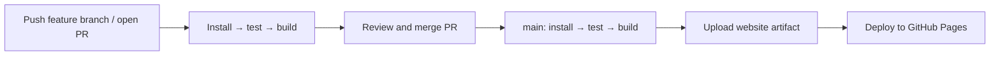

# Learn CI/CD with GitHub Actions

Build and publish a tiny website, then practice changing it through a pull request. The app uses JavaScript and Node.js 24 with no external npm packages. You do not need AWS, Docker, or a custom deployment secret.

## 1. Understand what you are building

**Continuous integration (CI)** automatically checks code when you push a change. Here it installs the project, tests the greeting function, and builds the website. A failure stops the job.

**Continuous deployment (CD)** automatically publishes a passing build. Here it publishes the tested website to GitHub Pages only from `main`. Continuous *delivery* usually adds a human release decision before publication; this example deploys automatically.



If any test fails, the pipeline stops before publishing. A green check covers the tested behaviors; it does not prove every possible website interaction works.

| Term | Meaning in this project |
| --- | --- |
| Repository | The GitHub project containing your files and history |
| Branch | A separate line of changes, such as `lesson/change-headline` |
| Commit | A saved snapshot of changes |
| Pull request (PR) | A request to review and merge a branch into `main` |
| Workflow | The automation defined in `.github/workflows/learn-cicd.yml` |
| Runner | A temporary Ubuntu machine provided by GitHub |
| Job | A group of steps; this workflow has `check` and `deploy` |
| Step | One command or reusable action within a job |
| Artifact | The built website passed from the check job to deployment |

## 2. Run the website locally

You need Git, a GitHub account, and Node.js 24 with npm. Node is already installed on the computer where this sample was created. On another computer, install Node.js 24 from [Node.js](https://nodejs.org/) first.

From the repository root in PowerShell:

```powershell
cd cicd-demo
node --version
npm ci
npm test
npm run build
npm run preview
```

Expected results: three passing tests, a generated `dist/` folder, and a server address. Open [the local website](http://127.0.0.1:3000), type your name, and click **Say hello**. Stop the server with **Ctrl+C**. Rebuild and refresh the browser after changing source files; this small server does not rebuild automatically.

| File | What to learn from it |
| --- | --- |
| `src/message.js` | The greeting function and editable headline |
| `src/index.html`, `src/style.css`, `src/app.js` | The website and browser interaction |
| `test/message.test.js` | Automated expectations for greeting behavior |
| `scripts/build.js` | Copies website files into `dist/` and adds commit/time information |
| `scripts/preview.js` | Serves the built files locally |
| `package.json` | Defines the `test`, `build`, and `preview` commands |
| `package-lock.json` | Committed installation lockfile used by `npm ci` |
| `../.github/workflows/learn-cicd.yml` | Tells GitHub when and how to run the pipeline |

Run commands from `cicd-demo`; GitHub automatically does this through `defaults.run.working-directory`. Edit `src/`, not generated `dist/` files. The commit label says `local` on your computer and shows the source commit after a GitHub build.

## 3. Put the files on GitHub and enable Pages

This workspace already has a Git remote pointing to `https://github.com/mikelys/playc.git`. Check it with `git remote -v` from the repository root. Use the existing repository if that is your intended destination. The sample has been prepared locally; publishing it requires committing and pushing.

If you want an independent practice repository, create an empty public repository in GitHub, copy `cicd-demo/` and `.github/workflows/learn-cicd.yml` into a new local folder, then initialize Git there. Keep the workflow under `.github/workflows` at the repository root, beside `cicd-demo/`. Do not copy this repository's `.git` directory or `.tools` directory. Add that new repository's URL as `origin` and use a `main` branch.

Public repositories support Pages on GitHub Free; private repository availability depends on your plan. See [GitHub's Pages workflow documentation](https://docs.github.com/en/pages/getting-started-with-github-pages/using-custom-workflows-with-github-pages).

Before your first deployment:

1. Open the target repository on GitHub.
2. Go to **Settings → Pages**.
3. Under **Build and deployment → Source**, select **GitHub Actions**. The workflow is already supplied; you do not need to generate another one.
4. If the repository restricts GitHub Actions, allow the official `actions/*` actions used in this workflow under **Settings → Actions → General**.

From the existing repository root, review and publish only the sample files:

```powershell
git status
git add README.md cicd-demo .github/workflows/learn-cicd.yml
git diff --cached
git commit -m "Add hands-on GitHub Actions CI/CD demo"
git push origin main
```

These commands assume you are on an up-to-date `main` branch and can push to it. Check `git branch --show-current` first. If `main` requires pull requests, commit on a new branch, push that branch, and merge a PR into `main` instead. Keep `dist/` out of Git; the workflow builds it.

## 4. Watch the first deployment

1. Open the repository's **Actions** tab and choose **Learn CI/CD**.
2. Open the latest run. Expand **Test and build demo** to see installation, tests, and build logs.
3. After that job passes, **Deploy website** publishes its artifact.
4. Open the website link shown by the deployment or **Settings → Pages**. For the existing repository it will normally be `https://mikelys.github.io/playc/`; use the actual deployment link as the source of truth.
5. Compare the commit label at the bottom of the site with the commit in the run. Refresh after the deployment completes; publication can take a little time.

This repository also has a workflow called **CI/CD** for the C program. Use **Learn CI/CD** for this lesson.

To run again without changing code: **Actions → Learn CI/CD → Run workflow**, select `main`, and run it. The workflow must exist on the repository's default branch before the manual-run option appears. Manually running a feature branch checks it but skips deployment.

## 5. Make your first change through a PR

Start from the repository root:

```powershell
git switch main
git pull --ff-only origin main
git switch -c lesson/change-headline
```

Edit `cicd-demo/src/message.js` and change only the `headline` text to something such as `Mike shipped this with GitHub Actions!`. Then run:

```powershell
cd cicd-demo
npm test
npm run build
cd ..
git add cicd-demo/src/message.js
git commit -m "Personalize the demo headline"
git push -u origin lesson/change-headline
```

On GitHub, open a pull request from that branch into `main`. Inspect the **Checks** tab and the diff. The tests and build should pass; deployment is skipped while the change stays on a feature branch. Merge the PR, watch the new `main` run, and refresh the published site to see your headline.

You may see both a push run and a pull-request run for the same commit. Both triggers are included so you can learn what starts a workflow.

## 6. Break a test, read the failure, and fix it

From an up-to-date `main`, create another branch, for example `lesson/failing-test`. In `src/message.js`, temporarily change:

```javascript
return `Hello, ${trimmed || 'learner'}!`;
```

to:

```javascript
return `Hi, ${trimmed || 'learner'}!`;
```

Run `npm test` from `cicd-demo`: it fails because the tests expect `Hello`. Commit and push this branch and open a PR. In **Actions**, open the failed **Test greeting behavior** step and compare expected and actual output. Later steps are skipped, and the deployed site stays at the previously deployed version.

Restore `Hello`, rerun tests, commit, and push to the same branch. GitHub runs checks again and updates the PR. This exercise shows how CI catches a behavior change before deployment. If you intentionally change the product behavior, update the relevant tests too, after deciding what the new behavior should be.

To prevent someone merging a failing PR, optionally configure a branch ruleset or branch protection for `main`, require pull requests and passing status checks, and select this workflow's **Test and build demo** check after it has run. A failed check by itself does not enforce a merge restriction. Availability of protection features depends on the repository and plan.

## 7. Read the workflow

Open `../.github/workflows/learn-cicd.yml` beside this guide.

| YAML setting | Effect |
| --- | --- |
| `on.push` | Runs CI for branch pushes, including `main` |
| `on.pull_request` | Checks proposed merges |
| `workflow_dispatch` | Adds the manual-run button |
| `runs-on` | Chooses the hosted runner |
| `uses` | Invokes an existing action, such as checking out code |
| `run` | Executes a command, such as `npm test` |
| `needs: check` | Requires the entire check job to succeed before deployment |
| `if` | Restricts artifact upload and deployment to non-PR runs on `main` |
| `permissions` | Gives checking read access; grants Pages and identity permissions only to deployment |
| `environment` | Records deployment history and the published URL under `github-pages` |
| `concurrency` | Allows only one active deployment in this group at a time |

`npm ci` installs exactly from the lockfile and fails if it disagrees with `package.json`. This demo has no external packages, but it teaches the command used in larger Node projects. `npm test` exits with an error on failure; GitHub then stops the job. `npm run build` creates the publishable files. The Pages upload action stores them, and the deploy job publishes that artifact without rebuilding it.

The built-in GitHub credentials are supplied during the workflow; do not create a personal access token for this deployment. Action version tags such as `@v7` select an action release series; they are separate from the app's Node.js version. Larger projects often pin actions to reviewed full commit SHAs for reproducibility.

## 8. Recover from a bad change

A green build can still contain an unwanted change. In GitHub, open the merged PR and use **Revert** when available, then merge the resulting revert PR after checks pass. That creates a new commit restoring the earlier code and triggers another deployment. It preserves history. Avoid resetting and force-pushing `main` for this exercise.

## Troubleshooting

| Symptom | What to check |
| --- | --- |
| No workflow appears | Push the YAML file into `.github/workflows` at the repository root; confirm Actions is enabled |
| `npm ci` cannot find the lockfile | Commit `cicd-demo/package-lock.json` and run in `cicd-demo` |
| Tests fail | Open the failed test step; run `npm test` locally and fix the expected behavior |
| Pages setup/deploy fails | Set **Settings → Pages → Source → GitHub Actions**; confirm repository/organization policy permits Pages and the workflow permissions |
| Deployment is skipped | Expected on PRs and feature branches; only `main` deploys |
| Deployment waits for approval | Inspect the `github-pages` environment's protection rules |
| Site shows older content | Wait for the latest `main` deployment, then refresh and compare its commit label |
| Preview says build missing | Run `npm run build` before `npm run preview` |
| Port 3000 is busy | Stop an earlier preview process with Ctrl+C |

If you rename your deployment branch, update both `refs/heads/main` conditions in the workflow and the guide's commands. The workflow checks all branches intentionally, so unrelated edits also trigger CI in this teaching repository.

## You have completed the lesson when…

- You can run the website and its tests locally.
- You can find the workflow and explain what triggers it.
- A PR checks code without deploying it.
- You have read a deliberate failure and fixed it on the same PR.
- A merged change passes CI and appears on the live site.
- You can explain how a revert publishes a correction.

Official references: [Node.js workflows](https://docs.github.com/en/actions/tutorials/build-and-test-code/nodejs), [Pages custom workflows](https://docs.github.com/en/pages/getting-started-with-github-pages/using-custom-workflows-with-github-pages), and [Pages source settings](https://docs.github.com/en/pages/getting-started-with-github-pages/configuring-a-publishing-source-for-your-github-pages-site).
